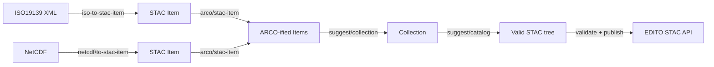

# End-to-end publishing tutorial

This tutorial walks the full EDITO Publishing Toolkit (EPT) workflow in four
scenarios, from raw metadata and data files to a published STAC catalog on the
EDITO platform — the same flow as the
[hands-on walkthroughs](ept-handson-tutorial/index.md), at the request level:

1. **Metadata items** — convert ISO19139 records from GeoNetwork into STAC Items.
2. **A data item** — a NetCDF file becomes a STAC Item whose geometry and
   temporal extent come from the file's own coordinates and CF attributes.
3. **ARCO data** — convert the Items' data assets in place (NetCDF → Zarr,
   GDB zip → GeoParquet).
4. **Collections, Catalog, publication** — suggest and export a Collection,
   then the Catalog (the tree is assembled by construction), validate it, and
   publish it to your EDITO catalog.



## Prerequisites

- A running EPT API (see [Install](../install.md)) — below we assume `http://localhost:8000`.
- An EDITO (DIVE) account with publishing rights.
- `curl` and `jq` on your PATH.

Set the API base once:

```bash
BASE=http://localhost:8000
```

## Step 0 — Authenticate

`POST /v1/auth` is form-encoded. A password grant returns API tokens **and**
temporary (24 h) S3 credentials for MinIO:

```bash
AUTH=$(curl -s -X POST $BASE/v1/auth \
  -d username="$EDITO_USERNAME" \
  -d password="$EDITO_PASSWORD")

TOKEN=$(echo $AUTH | jq -r .access_token)
REFRESH=$(echo $AUTH | jq -r .refresh_token)
S3_KEY=$(echo $AUTH | jq -r .s3_credentials.access_key_id)
S3_SECRET=$(echo $AUTH | jq -r .s3_credentials.secret_access_key)
S3_SESSION=$(echo $AUTH | jq -r .s3_credentials.session_token)
BUCKET=oidc-$(echo "$EDITO_USERNAME" | tr '[:upper:]' '[:lower:]')
```

All later calls send `Authorization: Bearer $TOKEN`. The S3 credentials are
request-scoped: pass them in each request body that touches S3 — EPT never
installs them into its own process environment. Output lands in your personal
`oidc-<username>` bucket (in a session or project, pass its bucket instead).

You can check which EDITO catalogs you can publish into:

```bash
curl -s $BASE/v1/edito/stac/mycatalogs -H "Authorization: Bearer $TOKEN"
# e.g. ["projects/my-project/catalogs/my-catalog"]
```

This lists the project catalogs you **own** — an empty response (`[]`) just
means you have not created any project catalogs yet.

---

## Scenario 1 — ISO19139 metadata to STAC Item

Convert a GeoNetwork record (exported as ISO19139 XML) into a STAC Item. Any
thematic domain works — bathymetry, biology, physics — as long as the record
has a geographic bounding box and usable temporal information.

```bash
curl -s -X POST $BASE/v1/metadata/iso-to-stac-item \
  -H "Authorization: Bearer $TOKEN" \
  -H "Content-Type: application/json" \
  -d '{
    "source_uri": "https://geo-service.example.org/geonetwork/srv/api/records/01234567-89ab-cdef-0123-456789abcdef/formatters/xml",
    "item_id": "my-vector-item",
    "bucket": "'$BUCKET'",
    "target": "items/vector",
    "overwrite": true,
    "endpoint_url": "https://minio.dive.edito.eu",
    "access_key_id": "'$S3_KEY'",
    "secret_access_key": "'$S3_SECRET'",
    "session_token": "'$S3_SESSION'"
  }' | jq .target_uri
```

Notes:

- `source_uri` accepts any HTTP(S) URL, including GeoNetwork
  `.../formatters/xml` endpoints.
- The Item is named `<item_id>.json` under `target` (when `item_id` is
  omitted, EPT proposes one from the ISO fileIdentifier, namespaced with
  your username — `<username>-<fileIdentifier>`); unique ids avoid
  publish-time collisions.
- Each Item's assets carry the record's online resources — here one of them is
  the data download (a `.zip` with the geodatabase), which scenario 3
  converts.
- `collection_id` is optional — the Collection step stamps it on the item
  copies.
- The record needs a geographic bbox and usable temporal information.

---

## Scenario 2 — A data item: NetCDF → STAC Item

### 2.1 (Optional) NetCDF → Zarr

Turn a single-file NetCDF into an Analysis-Ready Cloud-Optimized (ARCO) Zarr
store so it can be read by chunk over HTTP/S3 instead of downloaded whole.
This is the same conversion scenario 3 reruns from the Item's data asset:

```bash
curl -s -X POST $BASE/v1/transform/nc-to-zarr \
  -H "Authorization: Bearer $TOKEN" \
  -H "Content-Type: application/json" \
  -d '{
    "source_uri": "https://data-server.example.org/datasets/temperature_2024.nc",
    "bucket": "'$BUCKET'",
    "target": "data/netcdf",
    "endpoint_url": "https://minio.dive.edito.eu",
    "access_key_id": "'$S3_KEY'",
    "secret_access_key": "'$S3_SECRET'",
    "session_token": "'$S3_SESSION'",
    "consolidated": true,
    "overwrite": true
  }' | jq .target_uri
```

`source_uri` also accepts local files and OPeNDAP/GRIDDAP URLs. Consolidated
metadata (default on) makes opening the store from a client a single metadata
read.

### 2.2 NetCDF → STAC Item

`POST /v1/metadata/netcdf/to-stac-item` derives the bbox and temporal extent
from the file's own coordinates and CF attributes — no manual geometry:

```bash
curl -s -X POST $BASE/v1/metadata/netcdf/to-stac-item \
  -H "Authorization: Bearer $TOKEN" \
  -H "Content-Type: application/json" \
  -d '{
    "source_uri": "https://data-server.example.org/datasets/temperature_2024.nc",
    "item_id": "my-netcdf-item",
    "bucket": "'$BUCKET'",
    "target": "items/netcdf",
    "overwrite": true,
    "endpoint_url": "https://minio.dive.edito.eu",
    "access_key_id": "'$S3_KEY'",
    "secret_access_key": "'$S3_SECRET'",
    "session_token": "'$S3_SESSION'"
  }' | jq '{target_uri, bbox: .stac_item.bbox}'
```

Notes:

- Override the derived values with `bbox` and `start_datetime`/`end_datetime`
  when the source lacks CF coordinates/attributes.
- `target` is a prefix — the file is named after `item_id`
  (`my-netcdf-item.json`). When `item_id` is omitted, EPT proposes one from
  the dataset's own `id`/`identifier` attribute (else the source file name),
  namespaced with your username — `<username>-<identifier>`.
- The Item's data asset is the **NetCDF itself** — scenario 3 converts it to
  Zarr in place.

---

## Scenario 3 — ARCO items: convert data assets in place

`POST /v1/arco/stac-item` reads a hosted Item, converts its data assets, adds
the converted assets to the Item, and writes the updated Item back. With an
`s3://` source and **no `item_target`**, it re-exports **in place** — same
file, converted assets alongside the originals.

NetCDF assets auto-convert with `nc-to-zarr` (empty `conversions`); the vector
Item's plain `.zip` is ambiguous, so map it explicitly:

```bash
# my-netcdf-item — .nc asset, auto-detected
curl -s -X POST $BASE/v1/arco/stac-item \
  -H "Authorization: Bearer $TOKEN" \
  -H "Content-Type: application/json" \
  -d '{
    "source_uri": "s3://'$BUCKET'/items/netcdf/my-netcdf-item.json",
    "bucket": "'$BUCKET'",
    "assets_target": "data/netcdf",
    "conversions": {},
    "overwrite": true,
    "endpoint_url": "https://minio.dive.edito.eu",
    "access_key_id": "'$S3_KEY'", "secret_access_key": "'$S3_SECRET'",
    "session_token": "'$S3_SESSION'"
  }' | jq '{target_uri, conversions}'

# my-vector-item — .zip asset, explicit gdb-to-parquet
curl -s -X POST $BASE/v1/arco/stac-item \
  -H "Authorization: Bearer $TOKEN" \
  -H "Content-Type: application/json" \
  -d '{
    "source_uri": "s3://'$BUCKET'/items/vector/my-vector-item.json",
    "bucket": "'$BUCKET'",
    "assets_target": "data/vector",
    "conversions": {".zip": "gdb-to-parquet"},
    "overwrite": true,
    "endpoint_url": "https://minio.dive.edito.eu",
    "access_key_id": "'$S3_KEY'", "secret_access_key": "'$S3_SECRET'",
    "session_token": "'$S3_SESSION'"
  }' | jq '{target_uri, conversions}'
```

Notes:

- Each conversion adds an asset to the Item — `zarr`
  (`application/vnd+zarr`) or `parquet` (`application/vnd.apache.parquet`);
  original assets are kept.
- Auto-conversion: NetCDF assets → `nc-to-zarr`; `.gdb`/`.gdb.zip` →
  `gdb-to-parquet`; `.shp` → `shp-to-parquet`. A plain `.zip` is never
  auto-converted — map it explicitly (`gdb-to-parquet` needs exactly one
  file geodatabase in the archive, `shp-to-parquet` one or more `.shp` files;
  a missing `.gdb` fails with 422 → use `shp-to-parquet`).
- Converted data lands under `assets_target`; the response's
  `stage_timings_ms` shows per-stage wall time.

---

## Scenario 4 — Collections, Catalog, and publish

> Make the workspace folder public first (EDITO datalab → Storage → the
> folder's eyeball icon) — the Collection and Catalog steps read the hosted
> Items by public URL. World-readable while on: demo only, toggle it back off
> after the session.

### 4.1 Suggest and export a Collection

`POST /v1/stac/suggest/collection` fetches the hosted Items and derives
everything — extent (union of bboxes and datetimes), license, keywords, id —
and exports a complete, self-contained Collection folder in the same call:
`collection.json` plus one copy of each Item, links wired.

```bash
curl -s -X POST $BASE/v1/stac/suggest/collection \
  -H "Authorization: Bearer $TOKEN" \
  -H "Content-Type: application/json" \
  -d '{
    "item_links": [
      "https://minio.dive.edito.eu/'$BUCKET'/items/vector/my-vector-item.json",
      "https://minio.dive.edito.eu/'$BUCKET'/items/netcdf/my-netcdf-item.json"
    ],
    "title": "My collection",
    "bucket": "'$BUCKET'",
    "target": "collections/my-collection",
    "overwrite": true,
    "endpoint_url": "https://minio.dive.edito.eu",
    "access_key_id": "'$S3_KEY'", "secret_access_key": "'$S3_SECRET'",
    "session_token": "'$S3_SESSION'"
  }' | jq '{status, exported, collection_uri, item_uris, warnings}'
```

No `id` given — EPT proposes one, namespaced with your username
(`<username>-my-collection`, from the title slug); the proposal is in
`warnings` and the full location of what landed in `collection_uri`.
Pass your own username-prefixed `id` instead if you want to pin it.

Check `.warnings` for anything else EPT had to guess (for example a missing
license). The export stamps the id onto the item copies (`collection`
property plus `root`/`parent`/`collection` links), so the folder is complete
and self-rooted.

### 4.2 Suggest and export the Catalog — the final tree

`POST /v1/stac/suggest/catalog` fetches and validates each Collection, and
exports a self-contained tree in the same call: `catalog.json` at the root
with relative `child` links, each Collection copied underneath with its
`root`/`parent` links re-pointed at the catalog, item copies re-linked. **This
is the assembly** — the tree is assembled by construction, no separate
assemble step:

```bash
curl -s -X POST $BASE/v1/stac/suggest/catalog \
  -H "Authorization: Bearer $TOKEN" \
  -H "Content-Type: application/json" \
  -d '{
    "collection_links": [
      "https://minio.dive.edito.eu/'$BUCKET'/collections/my-collection/collection.json"
    ],
    "title": "My project catalog",
    "description": "All EDITO deliverables for my project.",
    "bucket": "'$BUCKET'",
    "target": "stac-final",
    "overwrite": true,
    "endpoint_url": "https://minio.dive.edito.eu",
    "access_key_id": "'$S3_KEY'", "secret_access_key": "'$S3_SECRET'",
    "session_token": "'$S3_SESSION'"
  }' | jq '{status, exported, catalog_uri, collection_uris, item_uris, warnings}'
```

No `id` here either — EPT proposes `<username>-my-project-catalog` (title
slug, namespaced with your username so it is unique among your catalogs);
the proposal is in `warnings`, the location in `catalog_uri`.

Alternative: instead of `collection_links`, pass `source_folder` =
`s3://$BUCKET/collections` — the folder of collection trees, each subfolder
one self-contained Collection. Same result.

### 4.3 Validate the hosted tree

`catalog_uri` from step 4.2 is the entry point; `validate_children` checks
every Item and Collection inside:

```bash
curl -s -X POST $BASE/v1/stac/validate \
  -H "Authorization: Bearer $TOKEN" \
  -H "Content-Type: application/json" \
  -d '{
    "stac_url": "https://minio.dive.edito.eu/'$BUCKET'/stac-final/catalog.json",
    "validate_children": true
  }' | jq '{stac_is_valid, summary}'
```

✅ Expected: `stac_is_valid: true` and `invalid_objects: 0`.

### 4.4 Publish to EDITO

Publication is asynchronous: `POST /v1/edito/stac/publish` returns `202` with a
`job_id`. It requires **both** the access token and the refresh token header,
because the queued job may outlive the access token:

```bash
curl -s -X POST $BASE/v1/edito/stac/publish \
  -H "Authorization: Bearer $TOKEN" \
  -H "X-EDITO-Refresh-Token: $REFRESH" \
  -H "Content-Type: application/json" \
  -d '{
    "remote_stac_url": "https://minio.dive.edito.eu/'$BUCKET'/stac-final/catalog.json",
    "catalog_id": "projects/my-project/catalogs/my-catalog"
  }' | jq
# {"job_id": "...", "status": "queued"}
```

`catalog_id` is the `projects/…` id of your project catalog — the tree you
built in 4.2 publishes under it. `GET /v1/edito/stac/mycatalogs` lists the
project catalogs you own (empty until you have created one). EPT adds the
infrastructure catalog root itself. `remote_stac_url` must be the exported
tree's root (`stac-final/catalog.json`, served over HTTPS).

### 4.5 Poll the job

```bash
JOB_ID=the-job-id-from-4-4

curl -s "$BASE/v1/edito/publish/jobs/$JOB_ID?view=summary" \
  -H "Authorization: Bearer $TOKEN" | jq
```

Use `?view=detail` or `?view=raw` for logs. Paginate with `limit` and `cursor`,
always following EPT's `next` link. Terminal statuses: `succeeded`, `failed`,
`cancelled`, `interrupted`.

### 4.6 (Optional) Remove a published catalog

`POST /v1/edito/stac/remove` is destructive and also needs the refresh-token
header:

```bash
curl -s -X POST $BASE/v1/edito/stac/remove \
  -H "Authorization: Bearer $TOKEN" \
  -H "X-EDITO-Refresh-Token: $REFRESH" \
  -H "Content-Type: application/json" \
  -d '{"catalog_id": "projects/my-project/catalogs/my-catalog"}' | jq
```

**That's the full pass** — metadata items, ARCO data, Collection and Catalog
assembled by construction, validated, and live on EDITO.

---

## Endpoint reference

| Step | Endpoint | Auth |
| --- | --- | --- |
| Tokens + S3 credentials | `POST /v1/auth` | none (form body) |
| My catalogs | `GET /v1/edito/stac/mycatalogs` | Bearer |
| ISO19139 → STAC Item | `POST /v1/metadata/iso-to-stac-item` | Bearer |
| NetCDF → Zarr | `POST /v1/transform/nc-to-zarr` | Bearer |
| NetCDF → STAC Item | `POST /v1/metadata/netcdf/to-stac-item` | Bearer |
| ARCO-ify Item (convert assets in place) | `POST /v1/arco/stac-item` | Bearer |
| GDB → GeoParquet | `POST /v1/transform/gdb-to-parquet` | Bearer |
| Upload file(s) to S3 | `POST /v1/storage/s3/upload` | Bearer |
| List my S3 buckets | `POST /v1/storage/s3/buckets` | Bearer |
| Suggest + export Collection | `POST /v1/stac/suggest/collection` | Bearer |
| Suggest + export Catalog | `POST /v1/stac/suggest/catalog` | Bearer |
| Build Item/Collection/Catalog | `POST /v1/stac/build/{item,collection,catalog}` | Bearer |
| Validate STAC tree | `POST /v1/stac/validate` | Bearer |
| Search EDITO STAC | `GET /v1/stac/find/...` | Bearer |
| Publish | `POST /v1/edito/stac/publish` | Bearer + `X-EDITO-Refresh-Token` |
| Job status | `GET /v1/edito/publish/jobs/{job_id}` | Bearer |
| Remove catalog | `POST /v1/edito/stac/remove` | Bearer + `X-EDITO-Refresh-Token` |

## Troubleshooting

- **401 on publish** — the refresh token is missing or stale; re-run step 0.
- **S3 `AccessDenied`** — the 24 h STS session expired; re-authenticate to mint
  new S3 credentials.
- **ISO conversion fails** — the record needs a geographic bounding box and
  usable temporal information (a `datetime`, or `start_datetime` +
  `end_datetime`).
- **GDB conversion fails** — the zip must contain exactly one `.gdb`; a
  shapefile zip needs `shp-to-parquet` (a missing `.gdb` fails with 422).
- **Job `failed`** — re-poll with `?view=detail`; the publisher logs name the
  offending STAC object.