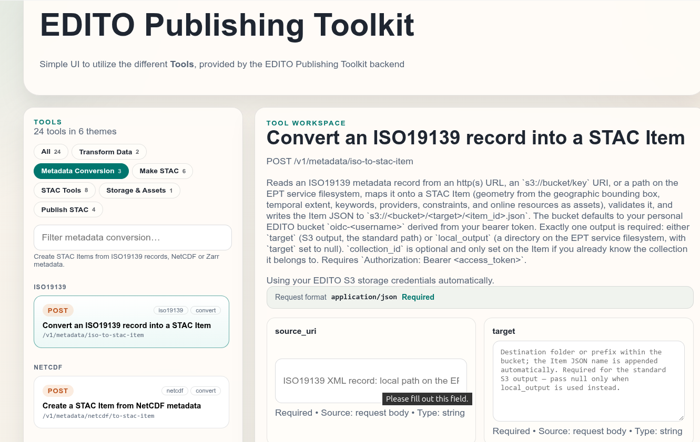
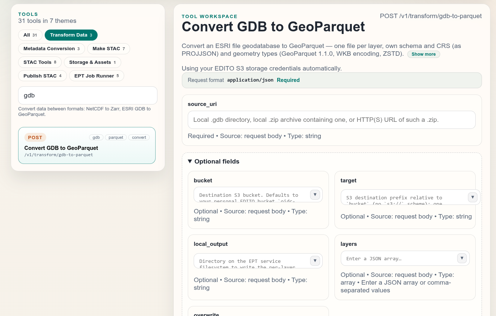
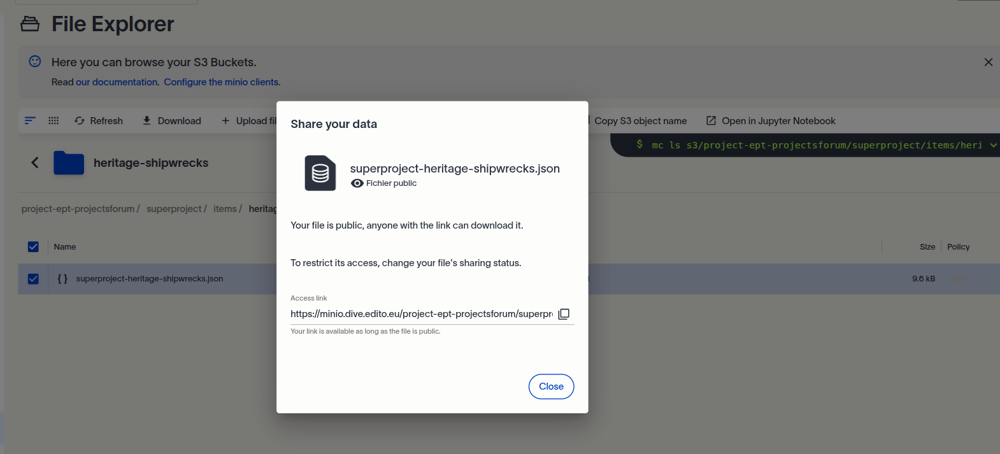
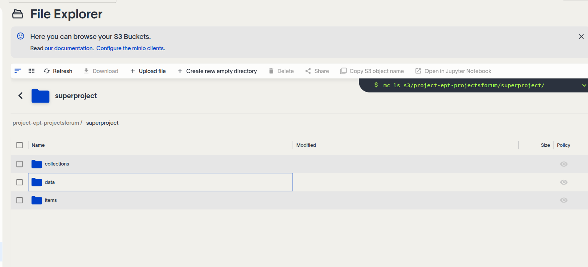

<!-- _class: lead -->


# EDITO Publishing Toolkit

### From metadata records and datasets to valid STAC and Cloud Optimized Data available on EDITO 

**EDITO Publishing Toolkit · Talk + Hands-On + Q&A**

<div class="funding">Funded by the European Union under grant agreement no. 101227771.</div>

---

  ## Agenda

| | | 
| --- | --- | 
| 1 | **Why EPT exists** — Simplifying Tooling |
| 2 | **EPT high level** — API, execution layer, external services, frontend |
| 3 | **Three ways to use EPT** — EDITO service, local API, local frontend |
| 4 | **STAC background** — the language of EDITO discovery |
| 5 | **ARCO background** — Zarr and GeoParquet |
| 6 | **Hands-on** — convert data → STAC Items → ARCO → building STAC → publish |
| 7 | **Wrap-up, questions** |

---

## Need for a Toolkit

Data providers on EDITO must deliver:

<div class="cardgrid">
<div>

**Standard metadata**

machine-readable → *STAC*

</div>
<div>

**Cloud-optimized data**

chunk-read over HTTP → *Zarr, GeoParquet*

</div>
<div>

**Hosted assets**

reachable by the platform → *S3 (MinIO)*

</div>
</div>

…into **their own catalog** in the EDITO STAC API. 

There are already a number of tools, libraries, frameworks to do this kind of work.  So to help streamline this for data providers, we are building the EPT

**EPT = one toolkit that does all of it, reproducibly.**

---

## What EPT is

**One API that does the publishing work** — the transformations and
conversions, executed in a clear, structured, reproducible way:

<div class="cardgrid">
<div>

**Convert**

ISO19139 → STAC · NetCDF → Zarr · GDB → GeoParquet

</div>
<div>

**Validate**

clean in, valid STAC out —
checked against STAC + EDITO rules

</div>
<div>

**Deliver**

local paths or S3 —
private or public data

</div>
</div>

Runs **local or in the cloud** — same API, same contract. Under the hood EPT
uses EDITO services (auth, S3 storage, STAC API, publication), but what you
code against is just EPT.

---

<!-- _class: divider -->

# Three ways to use EPT

### Zero install, local API, or local UI — all one contract

---

## Three ways to use EPT

<div class="columns" style="font-size:0.78em">
<div>

**1 — EDITO service (zero install)**

Datalab → Service Catalog → search `publishingtoolkit` → **Launch** → pick a
version, set your **resources**, start. Backend + frontend, ready to use:

`datalab.dive.edito.eu/launcher/service-playground/edito-publishing-toolkit-service`

**2 — Local API**

```bash
git clone https://github.com/EDITO-Infra/\
  edito-publishing-toolkit-backend
make install && make api-start
# API on http://localhost:8000 · or: make docker-deploy
```

</div>
<div>

**3 — Pull the images (no clone)**

```bash
# Backend
docker run -d --name ept-api -p 8000:8000 \
  ghcr.io/edito-infra/\
  edito-publishing-toolkit-backend:1.1.0-beta

# Frontend
docker run -d --name ept-frontend -p 3000:8080 \
  -e EPT_API_UPSTREAM=http://ept-api:8000 \
  --link ept-api ghcr.io/edito-infra/\
  edito-publishing-toolkit-frontend:1.1.0-beta
```

→ `http://localhost:3000`

**All three talk to the same API.**

Same tools, same results — pick per situation, switch any time.

</div>
</div>

---

## The frontend — every feature, no code

Open the frontend — **`localhost:3000`** locally or the service playground —
and sign in with your **EDITO account**.

<div class="columns" style="font-size:0.8em">
<div>

- Every capability is a **tool** in the sidebar, generated live from the
  OpenAPI schema — *always in sync*
- Fill the **form**, press **Run Tool**, inspect the JSON response
- Secrets (tokens, S3 keys) stay in your browser session only
- **Logs** page shows what the service did

</div>
<div>



</div>
</div>

---

## One consistent contract

Every feature speaks the same language:

- **REST + JSON**, OpenAPI docs at `/docs`
- **RFC 7807 Problem Details** errors with stable `reason` slugs
- **Bearer token** auth
- **Request-scoped S3 credentials** — your 24 h STS session travels in the
  request body, never into the server's environment

You rarely touch this by hand — the frontend and the Python client handle it —
but it's what makes EPT **scriptable**.

---

<!-- _class: divider -->

# STAC

### The language of EDITO discovery

---

## STAC — what it is

**SpatioTemporal Asset Catalog** — plain JSON linking catalog → collections →
items → assets.

```json
{
  "type": "Feature",
  "stac_version": "1.0.0",
  "id": "temperature-2024",
  "bbox": [-1.5, 49.0, 0.5, 50.5],
  "properties": {"datetime": "2024-06-01T00:00:00Z"},
  "assets": {
    "zarr": {"href": "https://minio…/temperature_2024.zarr",
             "type": "application/vnd+zarr"}
  }
}
```

- **Item** = one dataset, one place, one time · **Collection** = group of
  items with shared extents/license · **Catalog** = the root that ties it together

---

## STAC — the hierarchy

```text
Catalog                         ← root, ties it together
└── Collection                  ← shared extents, license
    ├── Item                    ← one dataset, one place, one time
    │   ├── Asset  Zarr         ← the actual data
    │   └── Asset  ISO19139     ← the metadata record
    └── Item
```

- Every object is **plain JSON with `links`** — no database, no server required
- Lives happily as **static files on S3** — crawlable, cacheable, versionable
- An Item **describes**; its **assets** point at the bytes

---

## STAC — why it matters here

EDITO's discovery layer **is** a STAC API. If your data is not STAC, it does
not exist for the platform.

Your ISO19139 records already hold everything STAC needs — bbox, temporal
extent, contacts, constraints, online resources. EPT does the mapping:

- **ISO19139, NetCDF, Zarr → valid STAC Items** — one call each
- **Items → Collections → Catalog** — one call each, derived from
  what you have
- **One linked, validated tree** on S3 — STAC spec + EDITO
  rules checked, children included
- **Search** the EDITO STAC API: items, collections, DOIs, assets

---

<!-- _class: divider -->

# ARCO

### Analysis-Ready, Cloud-Optimized data

---

## ARCO — why cloud-optimized formats

Read *chunks* over HTTP instead of downloading whole files.

| | Traditional | ARCO |
| --- | --- | --- |
| Read one timestep | download the whole archive | fetch one Zarr chunk |
| Read two columns | parse the full table | Parquet column scan |
| Where | local disk | any S3 / HTTP client |

Two formats cover almost everything on EDITO:

| Format | Replaces | Best for |
| --- | --- | --- |
| **Zarr** | NetCDF files | gridded/raster time series — random access by chunk |
| **GeoParquet** | Shapefiles, ESRI GDB | vector tables — columnar, compressed, fast scans |

---

## Zarr — chunks of an n-dimensional array

A Zarr store is just **a directory**: JSON metadata plus compressed chunk
files — no single "file" at all.

- `.zarray` / `.zattrs` hold shape, dtype, chunking; chunks are separate objects
- **Consolidated metadata** → one extra `.zmetadata` file, so a client opens
  the whole store with **a single read**
- Works on **any object store** — S3 keys are just files; no special server
- **v2 or v3**; EPT defaults to v2 for S3 output, consolidated on

> NetCDF holds one big file you must download whole. Zarr lets
> `xarray.open_zarr` fetch exactly the chunks you need — that is the whole win.

---

## GeoParquet — vector tables, columnar

Parquet stores a table **column by column**, compressed; GeoParquet adds the
geospatial convention (geometry column, bbox, CRS metadata) on top.

- **Columnar** → read only the columns you asked for; skip the rest
- **Compressed** → typically far smaller than shapefile/GDB equivalents
- CRS passes through untouched — **no reprojection, ever**

> Shapefiles and File Geodatabases were built for desktops.
> GeoParquet is built for HTTP range requests and fast scans.

---

## A toolbox, not a fixed recipe

Datasets differ — so does the work. What stays the same is the tooling:

- Each capability is a **named, versioned API endpoint** — inspectable at `/docs`
- The **frontend** calls exactly that API — nothing hides in a notebook
- Every request returns JSON, every failure a documented problem —
  **traceable end to end**

Which tools you call, and in what order, depends on the data — mostly it is
converting, sometimes searching, a little editing, validation along the way.
The next slides follow one full pass; the handbook tutorials hold the
step-by-step detail.

---

## Walkthrough tutorials

Step-by-step guides live in the handbook —
**`docs/tutorials/ept-handson-tutorial/walkthroughs`**, or in the frontend under
**Handbook → Tutorials**. Session setup — tokens, S3 credentials, bucket and
workspace folder — is at the top of the index.

Frontend, `curl` or `python`: same results, same tools — and check each
result in the viewers as you go.

---


## Before you start

- **Start the EPT service application or API** — the [service playground](https://datalab.dive.edito.eu/launcher/service-playground/edito-publishing-toolkit-service)
  (zero install), or `make api-start` / Docker locally
- **Bucket** — leave `bucket` empty and EPT uses your personal
  `oidc-<username>` bucket; in a session or project, pass its bucket instead
- Use a unique `<id>-output/` or `<username>-output/` for the base of your outputs onto the s3 storage
- **When asked, make it public (demo only)** — EDITO datalab → Storage → your
  `<workspace>` folder → eyeball icon. Everything in it becomes
  **world-readable**; toggle it back off after the session.

---

<!-- _class: scenario -->

<span class="badge">HANDS-ON · CONVERT</span>

# Converting to ARCO

Traditional formats in, cloud-optimized out — `source_uri` in, `target`
out, JSON back. Via a frontend form or one API call:

```python
post("/v1/transform/gdb-to-parquet",
     source_uri=GDB_ZIP_URL, bucket=BUCKET,
     target=f"{WORKSPACE}/data/shipwrecks",
     overwrite=True, **S3)
```

Same for **NetCDF → Zarr** — one call, ARCO-ready output, no
reprojection.

Check each result in the **Parquet explorer** and **NetCDF/Zarr viewer** —
sibling datalab services reading your S3 directly.

<!-- python: session setup + `post()` helper — handbook index -->

---

<!-- _class: scenario -->

<span class="badge">HANDS-ON · CONVERT</span>

# …in the frontend

<div class="columns">
<div>

**Convert GDB to GeoParquet** — same call as the API, no code:

- Paste the `.zip` URL (or pick a file already in your bucket)
- Set bucket + target prefix
- Submit — one Parquet file per layer

</div>
<div>



</div>
</div>

---

<!-- _class: scenario -->

<span class="badge">HANDS-ON · STAC ITEMS</span>

# Making STAC — from metadata

An adequate ISO19139 record comes with a number of the fields that STAC requires — bbox, temporal extent, contacts, constraints.

The **iso-to-stac-item** feature can do this conversion if the ISO metadata is adequate

**one record → one valid STAC Item** — repeat per record.

<div class="columns" style="font-size:0.85em">
<div>

```json
{
  "source_uri": "…/records/<uuid>/formatters/xml",
  "item_id": "<projectid>-mangrove",
  "collection_id": "<projectid>-habitats-and-heritage",
  "bucket": "<bucket>",
  "target": "<workspace>/items/mangrove"
}
```

</div>
<div>

```python
resp = post("/v1/metadata/iso-to-stac-item",
            source_uri=RECORD_URL,
            item_id=f"{PROJECTID}-mangrove",   # or omit: EPT proposes <username>-<fileIdentifier>
            collection_id=f"{PROJECTID}-habitats-and-heritage",
            bucket=BUCKET,
            target=f"{WORKSPACE}/items/mangrove",
            overwrite=True, **S3)
print(resp["target_uri"])
```

</div>
</div>

---

<!-- _class: scenario -->

<span class="badge">HANDS-ON · STAC ITEMS</span>

# …in the frontend

<div class="columns">
<div>

**Convert an ISO19139 record into a STAC Item** — same call as the API, no
code:

- Paste the record URL
- Set item id, collection, bucket + target
- Submit — one valid STAC Item out

</div>
<div>


</div>
</div>

---

## …and from the data itself

No metadata record? Build the Item from the dataset — extent derived from
the file's CF coordinates and attributes, no manual bbox or datetime:

```python
item = post("/v1/metadata/netcdf/to-stac-item",
            source_uri=DIN_NC_URL, bucket=BUCKET,
            target=f"{WORKSPACE}/items/din",
            item_id=f"{PROJECTID}-din",   # or omit: EPT proposes <username>-<dataset id>
            collection_id=f"{PROJECTID}-ocean-chemistry",
            overwrite=True, **S3)
print(item["stac_item"]["bbox"])

# make it yours later: post("/v1/stac/build/item", stac_json=item["stac_item"],
#     id="your-id", target="…/your-id.json", overwrite=True, **S3)
```

The Item's **data asset is the NetCDF itself** — that is what the ARCO step
converts.

---

<!-- _class: scenario -->

<span class="badge">HANDS-ON · STORAGE</span>

# Browse & share — the datalab File Explorer

<div class="columns">
<div>

Your S3 buckets in a UI — download, upload, and **share** any object via a
public link.

Share links are plain HTTPS URLs, so they double as `source_uri` inputs for
any EPT call.

</div>
<div style="flex:1.3">



</div>
</div>

<div class="hintbox" style="font-size:0.65em">Going further — buckets, access
policies, MinIO clients: see the storage section of the EDITO documentation.</div>

---

<!-- _class: scenario -->

<span class="badge">HANDS-ON · ARCO</span>

# ARCO-ify the items

One call converts an Item's data assets and re-exports the Item **in place**
— converted outputs land under `data/`:

<div style="font-size:0.78em">

```python
post("/v1/arco/stac-item",
     source_uri=f"s3://{BUCKET}/{WORKSPACE}/items/din/"
                f"{PROJECTID}-din.json",
     bucket=BUCKET, assets_target=f"{WORKSPACE}/data/din",
     conversions={},           # the .nc asset is auto-detected
     overwrite=True, **S3)
```

</div>

<div class="columns" style="font-size:0.72em">
<div>

**before**

```json
"assets": {
  "data": { "href": "…/Water_body_dissolved_inorganic_nitrogen.nc" }
}
```

</div>
<div>

**after**

```json
"assets": {
  "data": { "href": "…/….nc" },
  "zarr": { "href": "…/data/din/…zarr",
            "type": "application/vnd+zarr" }
}
```

</div>
</div>

---

<!-- _class: scenario -->

<span class="badge">HANDS-ON · STAC</span>

# Making a STAC Collection

**One call** — derives extent, license, keywords from your Items and exports
a self-contained Collection: `collection.json` + item copies, links wired.

```python
collection = post("/v1/stac/suggest/collection",
     item_links=[f"{MINIO}/{BUCKET}/{WORKSPACE}/items/mangrove/{PROJECTID}-mangrove.json",
                 f"{MINIO}/{BUCKET}/{WORKSPACE}/items/heritage-shipwrecks/{PROJECTID}-heritage-shipwrecks.json"],
     id=f"{PROJECTID}-habitats-and-heritage",   # or omit id → EPT proposes
                                                # <username>-<title slug>
     bucket=BUCKET, target=f"{WORKSPACE}/collections/{PROJECTID}-habitats-and-heritage",
     overwrite=True, **S3)
```

Check it alone: `/v1/stac/validate` with `validate_children` on the
collection URL.

---

<!-- _class: scenario -->

<span class="badge">HANDS-ON · STAC</span>

# STAC outputs in the datalab

<div class="columns">
<div>

Export your STAC to S3 storage — browse the outputs in the datalab **storage
explorer**.

If you need to use your output STAC in another feature, or view it in
[STAC browser](https://browser.moregeo.it/external/), you can copy the
**share** link from the JSON files.

</div>
<div style="flex:1.3">



</div>
</div>


---

<!-- _class: scenario -->

<span class="badge">HANDS-ON · STAC</span>

# Making a STAC Catalog

**One call** — fetches the Collections (+ their items via item links), unions
keywords/providers, exports `stac-final/catalog.json` with relative child
links + `<id>/` copies (standard STAC layout).

```python
catalog = post("/v1/stac/suggest/catalog",
     collection_links=[f"{MINIO}/{BUCKET}/{WORKSPACE}/collections/{cid}/collection.json"
                       for cid in (f"{PROJECTID}-habitats-and-heritage", f"{PROJECTID}-ocean-chemistry")],
     id=f"{PROJECTID}-catalog",   # or omit: EPT proposes <projectid>-<title slug>
     title="EPT hands-on tutorial",
     description="Datasets converted with the EDITO Publishing Toolkit.",
     bucket=BUCKET, target=f"{WORKSPACE}/stac-final", overwrite=True, **S3)
```

Validate `stac-final/catalog.json` with `validate_children`, then publish it.

*(`/v1/stac/assemble` remains optional — for relocating or merging trees)*

---

<!-- _class: scenario -->

<span class="badge">HANDS-ON · PUBLISH</span>

# Make it discoverable

Publish the validated `catalog.json` into your EDITO catalog
(`projects/…` id, e.g. `$PROJECTID-catalog`).

- A **queued job** — `202` + job id, poll until it succeeds
- Then it is live in the EDITO STAC API
- **Published ≠ necessarily public** — visibility of your project catalog
  beyond your project is granted on request to EDITO support
- Publish is deliberate: inspect the tree in the viewers first —
  `remove` undoes it
- `mycatalogs` lists the project catalogs you own —
  empty just means you have not created one yet

---


## Takeaways

- **One API, three ways in** — service playground, local API, local frontend:
  same tools, same contracts, switch any time
- **STAC is the contract** — plain JSON catalog → collection → item → asset
- **ARCO is the data** — Zarr for grids, GeoParquet for vectors: read chunks
- **Verify conversions as you go** — the NetCDF/Zarr viewer and Parquet explorer
- **Docs & tutorials** — `docs/` in the repo, or Handbook → Tutorials in the frontend

<!-- _class: lead -->

# Questions?

<div class="funding">Funded by the European Union under grant agreement no. 101227771.</div>


